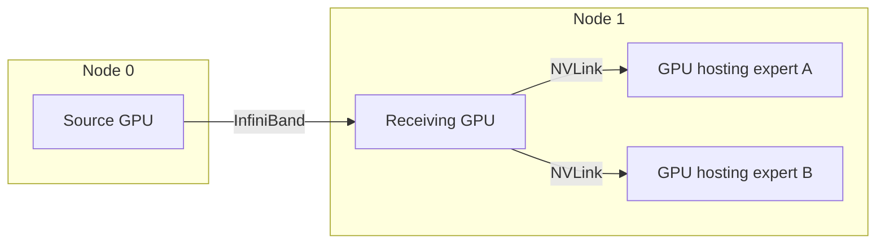

# L00 · Why would 2,048 GPUs spend time waiting?

[简体中文](README.zh-CN.md) · [Curriculum](../../docs/curriculum.md)

**15 minutes · T0 · Python 3.12, standard library · GPU cost $0.** If you can follow a tensor's shape and run a Python script, you can do this lesson. By the end you should be able to predict when a faster kernel leaves a training stage waiting on the network, and say which measurement would test your prediction.

## 0–3 min · Follow one token

In a mixture-of-experts (MoE) layer, the router chooses experts for a token. Each chosen expert needs its activation vector. Where those experts live determines which links carry that vector.

DeepSeek reports training V3 on 2,048 H800s, eight GPUs per node. Its dispatch kernel sends an activation across InfiniBand to each destination node, then forwards it over NVLink to the GPUs hosting the selected experts. V3 limits a token's destinations to at most four nodes. DualPipe also schedules independent work during communication. The paper describes node boundaries. Identifying a rack crossing would require rack placement and network topology. [V3 v2, §§3.1–3.2.2](https://arxiv.org/html/2412.19437v2#S3)

Here is a course schematic for two remote experts on the same node. Count how many copies cross the node boundary.



R1 adds a later systems question. R1 and R1-Zero start from V3-Base and use reinforcement learning. When generated responses have different lengths, what would you measure to tell whether rollout workers finish together? Return to that question in L13. [R1 v1, §2](https://arxiv.org/html/2501.12948v1#S2)

## 3–9 min · Predict the outgoing bytes

This pencil-and-Python model follows **one source node and one direction of dispatch**. All 8,192 tokens choose the same four distinct experts. Each token carries 4,096 values at two bytes each. The source sends each token once per distinct remote node. A local expert adds zero outgoing bytes. Assume one shared outbound link can deliver 16 MiB/ms. These are classroom inputs.

| Layout | Node IDs of experts A, B, C, D | Your prediction |
| --- | --- | --- |
| Spread | 1, 2, 3, 4 | How many copies leave node 0 per token? |
| Packed | 1, 1, 1, 1 | How much traffic remains if all four experts share a remote node? |
| Mixed | 0, 1, 1, 2 | Which expert needs no remote copy? Which two share one? |

Write down the payload and transfer time for each layout. Run from the repository root to check your arithmetic.

```bash
python3 lessons/l00/dispatch.py --nodes 1 2 3 4
python3 lessons/l00/dispatch.py --nodes 1 1 1 1
python3 lessons/l00/dispatch.py --nodes 0 1 1 2
```

## 9–15 min · Would a 2× faster kernel help?

A different microbatch has 6 ms of computation ready when dispatch begins. The serial schedule finishes after their sum. Under ideal overlap, both start at time zero, run at unchanged speed and finish after the longer duration. Predict both schedules before halving the compute time.

```bash
python3 lessons/l00/dispatch.py --nodes 1 2 3 4 --compute-ms 3
python3 lessons/l00/dispatch.py --nodes 1 1 1 1 --compute-ms 3
```

<details>
<summary>Check your predictions and the critical path</summary>

One copy of the batch is 8,192 × 4,096 × 2 bytes = 64 MiB. Multiply by the number of distinct remote nodes and divide the resulting MiB by 16 MiB/ms.

| Layout | Payload | Dispatch | Serial at 6 ms compute | Ideal overlap at 6 ms | Ideal overlap at 3 ms |
| --- | ---: | ---: | ---: | ---: | ---: |
| Spread | 256 MiB | 16 ms | 22 ms | 16 ms | 16 ms |
| Packed | 64 MiB | 4 ms | 10 ms | 6 ms | 4 ms |
| Mixed | 128 MiB | 8 ms | 14 ms | 8 ms | 8 ms |

In the packed timeline, communication occupies [0, 4] ms and computation [0, 6] ms. Speeding up compute exposes the last millisecond of communication. In the spread timeline, dispatch already determines the finish time. Real overlap needs independent work and enough shared resources. An expert computing on this very token must still wait for its input. The model excludes return traffic (combine), local forwarding time, contention and pipeline fill/drain. Its times are analytical predictions.

</details>

**Exit ticket.** Packing the experts cuts outgoing bytes. Could it still slow a job? Give one reason and one test. For example, a packed node could receive more expert work than its neighbors. In L11, count tokens per expert and aggregate by rank, then compare the slowest rank's completion time. In L07, record per-node transmit bytes to check the traffic prediction. In L01–L02, use a CPU/GPU timeline to locate actual waiting. L14 returns to the full V3 schedule.
