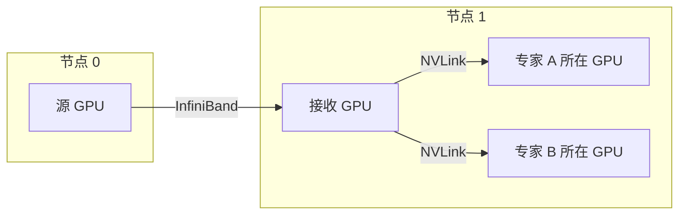

# L00 · 2,048 张 GPU，为什么还会等？

[English](README.md) · [课程总表](../../docs/curriculum.md)

**15 分钟 · T0 · Python 3.12 标准库 · GPU 费用为零。** 能看懂张量形状、会运行 Python 脚本，就可以开始。学完后，你能判断什么时候算子快了一倍，整个阶段却仍要等网络，也能说出该测什么来验证判断。

## 0–3 分钟 · 跟着一个 token 走

混合专家（MoE）层里的路由器为每个 token 选择专家。每个被选中的专家都需要收到这个 token 的激活向量。向量会经过哪些链路，取决于专家放在哪些 GPU 上。

DeepSeek 报告中，V3 使用 2,048 张 H800，每个节点八张卡。分发算子先通过 InfiniBand 把激活发到目标节点，再用 NVLink 转给承载目标专家的 GPU。每个 token 最多发往四个节点。DualPipe 则在通信期间安排其他可独立执行的计算。论文描述了节点边界；要确认一次通信是否跨机架，还需要机架部署和网络拓扑信息。[V3 v2，第 3.1–3.2.2 节](https://arxiv.org/html/2412.19437v2#S3)

下图是课程示意图。两个远端专家在同一节点，数一数有几份激活跨过了节点边界。



R1 把问题延伸到后训练。R1 和 R1-Zero 从 V3-Base 出发，使用强化学习。如果生成的回复长短不同，要观察什么才能知道各个 rollout worker 有没有互相等待？L13 会回到这个问题。[R1 v1，第 2 节](https://arxiv.org/html/2501.12948v1#S2)

## 3–9 分钟 · 先算要发多少字节

这个纸笔和 Python 练习只看**一个源节点的单向分发**。8,192 个 token 都选择相同的四个不同专家。每个 token 的激活含 4,096 个元素，每个元素两字节。每个 token 向每个不同的远端节点各发一份，本地专家不增加出节点流量。假设共享出口的有效带宽为 16 MiB/ms。这里的数值都是教学设定。

| 布局 | 专家 A、B、C、D 所在节点 | 先预测 |
| --- | --- | --- |
| 分散 | 1、2、3、4 | 每个 token 要从节点 0 发出几份？ |
| 集中 | 1、1、1、1 | 四个专家都在同一个远端节点，还要发多少数据？ |
| 混合 | 0、1、1、2 | 哪个专家无需远端副本？哪两个共用一份？ |

先写出每种布局的字节数和传输时间，再在仓库根目录运行命令核对。

```bash
python3 lessons/l00/dispatch.py --nodes 1 2 3 4
python3 lessons/l00/dispatch.py --nodes 1 1 1 1
python3 lessons/l00/dispatch.py --nodes 0 1 1 2
```

## 9–15 分钟 · 算子快一倍，能省几毫秒？

开始分发时，另一个微批次恰好有 6 ms 的计算可以独立执行。串行时，两段耗时相加。理想重叠时，两者同时开始，各自保持原速，最后一项结束的时刻决定总耗时。先预测两种调度的耗时，再把计算时间减半。

```bash
python3 lessons/l00/dispatch.py --nodes 1 2 3 4 --compute-ms 3
python3 lessons/l00/dispatch.py --nodes 1 1 1 1 --compute-ms 3
```

<details>
<summary>展开核对计算和关键路径</summary>

一份完整激活是 8,192 × 4,096 × 2 字节，即 64 MiB。乘以不同远端节点的数量得到发送量，再除以 16 MiB/ms 就得到传输时间。

| 布局 | 发送量 | 分发 | 计算 6 ms、串行 | 计算 6 ms、理想重叠 | 计算 3 ms、理想重叠 |
| --- | ---: | ---: | ---: | ---: | ---: |
| 分散 | 256 MiB | 16 ms | 22 ms | 16 ms | 16 ms |
| 集中 | 64 MiB | 4 ms | 10 ms | 6 ms | 4 ms |
| 混合 | 128 MiB | 8 ms | 14 ms | 8 ms | 8 ms |

集中布局下，通信占用 [0, 4] ms，计算占用 [0, 6] ms。计算降到 3 ms 后，最后 1 ms 的通信露了出来。分散布局下，分发从一开始就决定结束时间。实际重叠需要可独立执行的工作和足够的共享资源；负责当前 token 的专家仍须等输入到达。模型省略了结果回传（combine）、节点内转发耗时、资源争用，以及流水线填充与排空。表中时间均为模型推算。

</details>

**交一道诊断题。** 集中放置专家减少了出节点流量，为什么整步训练仍有可能变慢？给一个原因，再给一个可以验证它的指标。例如，集中放置可能让一个节点承担更多专家计算。L11 会统计每个专家的 token 数，按 rank 汇总，再看最慢 rank 的完成时间。L07 用每个节点的发送字节数验证流量预测；L01–L02 用 CPU/GPU 时间线定位实际等待；L14 再复盘 V3 的完整调度。
